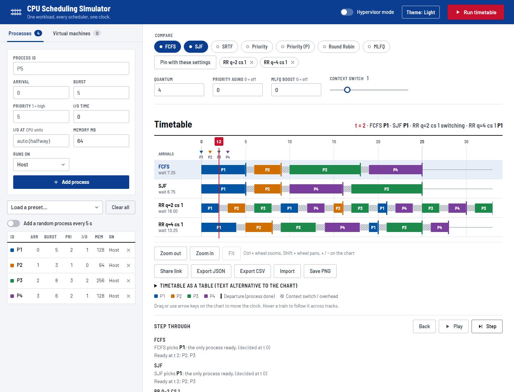

# CPU Scheduling Simulator

[](https://github.com/Divyansh3105/CPU-Scheduling-Simulator-/actions/workflows/ci.yml)

**[Live demo](https://divyansh3105.github.io/CPU-Scheduling-Simulator-/)** (runs entirely in your browser)



Compare CPU scheduling algorithms on one workload. Pick several algorithms, run once, and read them side by side on a shared clock. An optional hypervisor mode adds a VM scheduler on top.

Built with plain HTML, CSS and vanilla JavaScript. The scheduler runs in the browser (`public/assets/js/engine/`), so the site can be hosted statically. The PHP endpoints are an equivalent implementation, kept in step by a parity test. There is no build step.

## Features

- **Seven algorithms:** FCFS, SJF, SRTF, Priority (lower number = higher priority) in non-preemptive and preemptive forms, Round Robin, and MLFQ (three levels, quantum q, 2q, 4q).
- **Anti-starvation options:** priority aging for both Priority variants, and a periodic boost for MLFQ. Both are off by default (0).
- **Timetable chart:** one track per algorithm on a shared time axis, with arrival and departure markers, idle time, and context-switch overhead.
  - Drag the red clock hand, or use the arrow keys (Shift moves by 10), to see what every algorithm is running at that moment.
  - Hover a process to follow it across all tracks.
- **Comparison table:** average turnaround, waiting and response time, throughput, CPU busy %, and context switches, with the best value per column marked. Select a row for its per-process results.
- **Live re-run:** change the algorithm set, quantum, or overhead and every track updates.
- **Hypervisor mode:** define VMs and assign processes to them.
  - VM schedulers: round robin, priority, proportional share, credit, lottery (seeded, so reproducible).
  - Optional live migration, memory overcommit, I/O blocking, a CPU cache model, and a NUMA penalty; each changes the timeline.
  - Any process algorithm works inside a VM, including MLFQ with per-process levels.
- **Presets** for processes and VMs, and an optional "add a random process every 5 s" generator.

## Run it

Serve the `public/` folder with any static server. PHP 8.1 or newer works:

```bash
php -S localhost:8000 -t public
```

Then open <http://localhost:8000>. Opening `index.html` as a file won't work (browsers block ES modules on `file://`). The page uses the JavaScript engine by default; add `?backend=php` to the URL to run the same request through the PHP endpoints instead.

**GitHub Pages:** `.github/workflows/pages.yml` publishes `public/` on every push to `main`. Turn it on once under Settings > Pages > Source = GitHub Actions.

GSAP and Lenis (animation and smooth scrolling) and the Barlow fonts are bundled in `public/assets/vendor/` and `public/assets/fonts/`, so the page makes no requests to third parties. See [public/assets/vendor/README.md](public/assets/vendor/README.md) for versions, licences and checksums.

## How scheduling is modelled

- **Context switch:** the overhead (0 to 5 in steps of 0.5) is charged, and counted, whenever the CPU dispatches a different process than the one that ran last. The first dispatch is free.
- **Timing metrics:** turnaround = completion − arrival; waiting = turnaround − burst; response = first run − arrival.
- **Ties:** among equal candidates, the process that arrived first runs first.
- **Round Robin / MLFQ:** new arrivals join the queue before a preempted process is re-queued. MLFQ demotes a process after it uses a full quantum.
- **MLFQ preemption:** a slice running below the top level ends when a new job arrives. The preempted job keeps its level and goes to the back of that queue. Top-level slices (and Round Robin) are never cut short.
- **MLFQ boost:** every N time units all jobs return to the top level. The boost is applied the next time the CPU is dispatched, not in the middle of a slice.
- **Priority aging:** every N time units spent waiting improves a priority number by one, down to 1. A running process's wait clock resets whenever it runs. In the preemptive variant the clock advances one unit at a time while aging is on. A running process keeps the CPU on ties.
- **Hypervisor I/O:** a process with an I/O time blocks at each of its *I/O points*, given as CPU units into the burst (for example `2,5`). With no points it blocks once, halfway through. One device serves requests; when it frees up it takes the waiting request with the best priority number, oldest first.
- **NUMA penalty:** VMs alternate between two NUMA nodes in list order. When the CPU moves to a VM on the other node, 2 time units are added (shown as a NUMA hop on the chart).
- **Hypervisor limits:** aging is not applied inside VMs (Priority (P) works there without it).

## Input limits

The server validates every request and returns a 4xx with a message if a limit is broken.

| Field | Limit |
| --- | --- |
| Processes / VMs | up to 100 / 20 |
| Process ID, VM name | 1–32 characters: letters, digits, space, `_ . -` (`Host` and `__proto__` are reserved) |
| Total burst time | at most 20000 across all processes (keeps the schedule and response small) |
| Arrival | 0–10000 |
| Burst | 1–1000 |
| Quantum, VM time slice | 1–1000 |
| I/O points | up to 10 per process, each from 1 to burst − 1 |
| Priority aging, MLFQ boost | 0–1000 and 0–10000 (0 = off) |
| Request body | 64 KB |

## Configuration

Environment variables, read by the PHP endpoints:

| Variable | Default | Meaning |
| --- | --- | --- |
| `ALLOWED_ORIGIN` | unset | A single origin allowed to make cross-origin POSTs. By default the API is same-origin only. |
| `RATE_LIMIT_PER_MIN` | `300` | Requests per client per minute across both endpoints. `0` turns the limit off. |
| `RATE_LIMIT_IP_HEADER` | unset | Name of a `$_SERVER` key (for example `HTTP_X_FORWARDED_FOR`) to read the client address from. Set it only behind a reverse proxy you control, because clients can forge it otherwise. |

## Security and hosting

- **Rate limiting:** over the limit, the API answers `429` with a `Retry-After` header. Counters are small files in the system temp directory; if that directory isn't writable the limiter lets requests through rather than failing. A run of up to six algorithms is six requests, so the default allows dozens of runs a minute. Behind a proxy without `RATE_LIMIT_IP_HEADER`, every visitor shares one counter.
- **Headers:** a `<meta>` tag can't carry `frame-ancestors` or HSTS, so deploy with one of the ready-made configs:
  - Apache: the included [public/.htaccess](public/.htaccess) (needs `mod_headers`).
  - nginx: [deploy/nginx.conf](deploy/nginx.conf), an example server block for PHP-FPM.
  Both send a strict CSP (`default-src 'self'`, no inline script or style), `frame-ancestors 'none'`, `nosniff`, a no-referrer policy and HSTS over HTTPS, and both hide dotfiles. In nginx only the two `api/` endpoints reach PHP.
- **Web root:** point the server's document root at `public/`. The PHP library code in `src/`, the tests and the deploy files then can't be requested at all, whatever the server configuration.
- **No third-party requests:** scripts and fonts are served from this repository, so visits don't reveal the visitor's address to Google or a CDN, and there are no script hashes to keep in sync.
- Also set `display_errors=0` in production (the endpoints already do this at runtime) and keep the folder out of a web-writable location.

## Tests

```bash
php tests/check.php        # PHP endpoints against hand-computed schedules
node tests/parity.mjs      # JS engine vs PHP on ~1000 random workloads (needs php)
npx playwright test        # browser smoke test (npm install first)
```

`npm test` runs all three. Set `CHROMIUM_PATH` to reuse an installed Chromium instead of `npx playwright install chromium`.

`check.php` runs both endpoints from the command line against hand-computed schedules, checks that bad input is rejected, and unit-tests the rate limiter. It only runs from the command line. It prints one line per check and exits non-zero if any fail.

## Project layout

```
public/                     web root: the only folder the server exposes
  index.html                the single-page UI
  .htaccess                 Apache security headers
  api/
    simulate.php            standard scheduling endpoint
    simulate_hypervisor.php hypervisor scheduling endpoint
  assets/
    css/styles.css
    js/                     ES modules: state, workload, run, api, results, chart, stepper, presets, main
      engine/               the scheduler in JavaScript (timeline, validate, simulate, hypervisor)
    vendor/                 bundled GSAP and Lenis, with licences and checksums
    fonts/                  bundled Barlow (latin subset)
src/                        PHP library code, not web-reachable
  bootstrap.php             constants, headers, CORS, rate limiting, JSON helpers
  validation.php            request field validation
  Timeline.php              the schedule recorder and metrics engine
tests/check.php             PHP endpoint self-check
tests/parity.mjs            JS engine vs PHP cross-check
tests/e2e/                  Playwright smoke test
docs/screenshot.png         README screenshot
deploy/nginx.conf           example nginx server block
```

`PRODUCT.md`, `DESIGN.md` and `.impeccable/` hold product and design notes for the design tooling.

## License

See [LICENSE](LICENSE).
